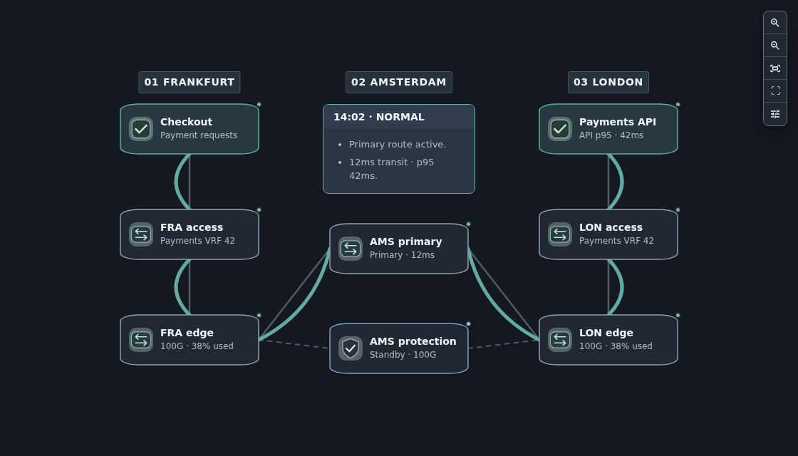

<!-- Generated from scripts/sync-content.mjs and canonical content fragments. Do not edit this file directly. -->
# TopoViewer

Build interactive network and service diagrams from YAML. Keep stable object IDs,
relationships, and reusable styles in Git; use the same bundle in documentation,
React applications, and Studio.

<a href="topoviewer/start/first-topology/"><strong>Build a docs page</strong> Python and MkDocs · two routers and one link</a>
<a href="topoviewer/examples/use-cases/react/"><strong>Embed in React</strong> A small component with selection and diagnostics</a>
<a href="topoviewer/author/studio/first-project/"><strong>Create visually</strong> Hosted Studio · create, save, export, and reopen</a>

## See The Result

The [Payments walkthrough](topoviewer/examples/use-cases/service-provider-network.md)
compares normal, degraded, and recovered states using the same object identities.
These are authored example states; TopoViewer renders the supplied model.

## Find Your Next Task

| Task | Guide |
|---|---|
| Choose graph objects and relationships | [Choose graph objects](topoviewer/reference/topology-model.md) |
| Write and validate a YAML bundle | [Create a bundle](topoviewer/author/authoring-model.md) · [Validate YAML](topoviewer/author/validate-yaml.md) |
| Embed in a product or documentation | [Integration guides](topoviewer/examples/use-cases/index.md) |
| Borrow a visual technique | [Examples and guided scenarios](topoviewer/examples/index.md) |
| Look up a field, style key, or callback | [Fields](topoviewer/reference/object-attributes.md) · [Styles](topoviewer/reference/stylesheet-reference.md) · [Component props](topoviewer/reference/component-props.md) |
| Diagnose a problem or upgrade | [Troubleshooting](topoviewer/author/debug-rendering.md) · [Upgrade](topoviewer/start/upgrade.md) |

React and MkDocs are Supported. The Zensical adapter is Supported Adapter;
Browser Studio is Beta Preview; Desktop Studio and Grafana are Experimental.
See [compatibility](topoviewer/reference/compatibility.md) before choosing a host.

[Which documentation version am I reading?](topoviewer/start/documentation-versions.md)
